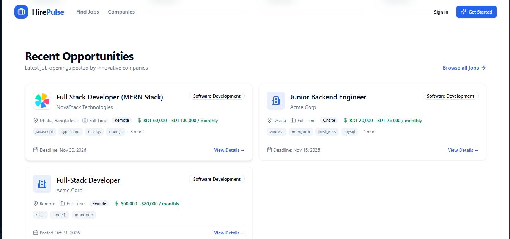
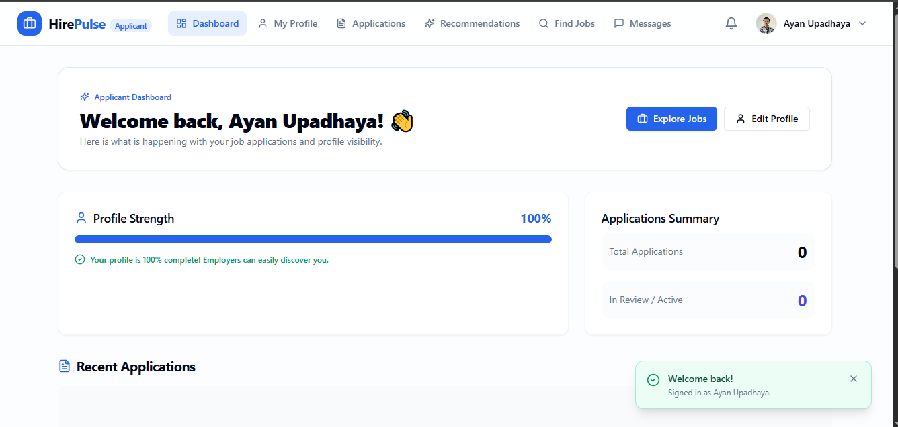
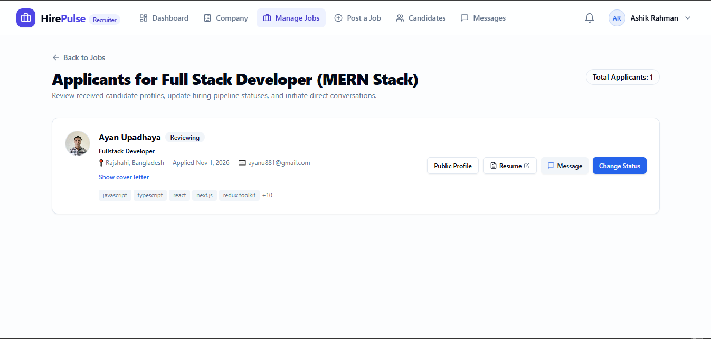
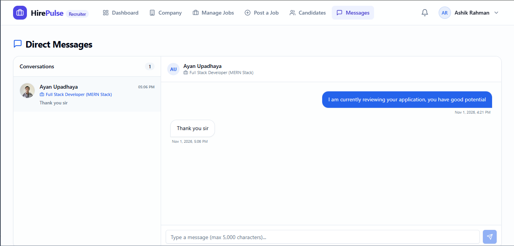
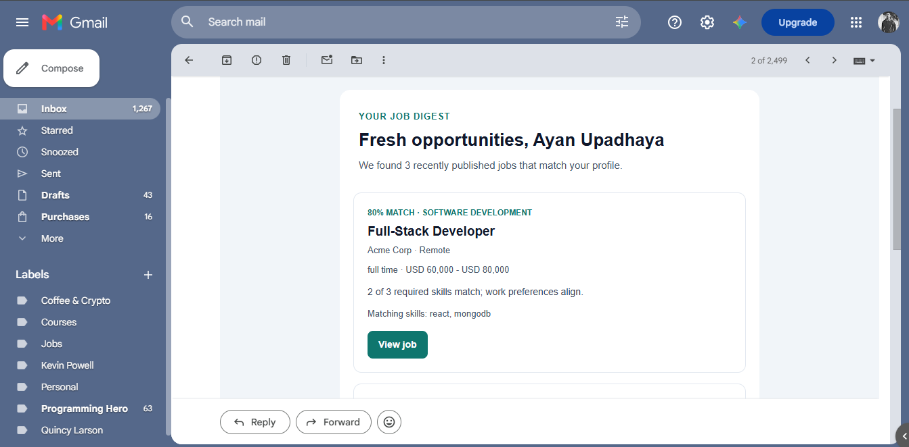

# HirePulse

HirePulse is an AI-assisted recruitment marketplace MVP that helps applicants find opportunities and helps recruiters manage hiring in one place. Applicants can build a profile, apply to jobs, track application progress, and receive personalized job recommendations. Recruiters can publish jobs, review applicants, discover candidates, and communicate with applicants. Matching and AI features support users; they do not make hiring decisions.

## Screenshots


| Screen | Screenshot |
| --- | --- |
| Home and job discovery |  |
| Applicant dashboard and profile |  |
| Job posting and applicant review |  |
| Messaging |  |
| Email Recommendations |  |

## Features

### Applicants

- Register and manage a professional profile, including skills, work experience, education, and resume.
- Search published jobs, view job details, and apply with an optional cover letter.
- Track application statuses and withdraw eligible applications.
- Get profile-based job recommendations and opt in to recommendation emails.
- View discoverable applicant profiles while signed in.
- Message recruiters and manage notifications.
- Request consent-based AI job-match insights.

### Recruiters

- Create and manage a company profile and job postings.
- Generate editable job-description drafts with the optional AI assistant.
- Review applications, cover letters, resumes, and hiring status.
- Discover candidate recommendations and message applicants.
- Manage notifications and account settings.

### Administrators

- Manage platform users and job categories.
- Review jobs and access administrative recommendation views.

### Platform

- Role-based authentication and authorization for applicants, recruiters, and admins.
- Explainable applicant/job matching, including salary-period-aware comparisons.
- Optional scheduled recommendation emails for applicants who opt in.

## Technology stack

| Area | Technologies |
| --- | --- |
| Frontend | React 18, Vite, React Router, Redux Toolkit, RTK Query, Tailwind CSS, React Hook Form, Zod |
| Backend | Node.js (18+), Express 4, Mongoose 8, Zod |
| Database | MongoDB |
| Authentication | JWT access tokens and secure refresh-token cookies |
| Optional integrations | OpenRouter for AI, Cloudinary for resume uploads, SMTP for recommendation emails |

## Run locally

### Prerequisites

- Node.js 18 or later and npm.
- MongoDB running locally, or a MongoDB Atlas connection string.
- Git.

### 1. Configure the backend

In PowerShell:

```powershell
cd server
Copy-Item .env.example .env
```

Edit `server/.env` and set at least:

```dotenv
NODE_ENV=development
PORT=5000
MONGO_DEV_URI=mongodb://127.0.0.1:27017/hirepulse
MONGO_PROD_URI=

# Generate with: node -e "console.log(require('crypto').randomBytes(64).toString('hex'))"
JWT_ACCESS_SECRET=change_me_access
JWT_REFRESH_SECRET=change_me_refresh

ACCESS_TOKEN_EXPIRES=20m
REFRESH_TOKEN_DAYS=7

# Comma-separated list of allowed frontend origins
CLIENT_URL=http://localhost:5173

# Cloudinary resume uploads
CLOUDINARY_CLOUD_NAME=
CLOUDINARY_API_KEY=
CLOUDINARY_API_SECRET=
CLOUDINARY_RESUME_FOLDER=

# SMTP email for scheduled job recommendation digests
SMTP_HOST=
SMTP_PORT=587
SMTP_SECURE=false
SMTP_USER=
SMTP_PASSWORD=
EMAIL_FROM=http://localhost:5173
FRONTEND_URL=
RECOMMENDATION_EMAIL_CRON=0 0 * * *
APP_TIMEZONE=Asia/Dhaka
RECOMMENDATION_EMAIL_MAX_JOBS=5
RECOMMENDATION_EMAIL_MIN_SCORE=40

# OpenRouter AI features (keep the API key server-side)
OPENROUTER_API_KEY=
OPENROUTER_MODEL=openai/gpt-4o-mini
OPENROUTER_API_URL=https://openrouter.ai/api/v1/chat/completions
OPENROUTER_TIMEOUT_MS=30000

# Use "none" only when frontend and API are on different sites (requires HTTPS)
COOKIE_SAMESITE=lax
# Set true when running behind a proxy (Render, Railway, Nginx...)
TRUST_PROXY=false

# Used by `npm run seed`
ADMIN_EMAIL=admin@example.com
ADMIN_PASSWORD=Admin12345

```

The server requires both MongoDB URI variables even during local development. With `NODE_ENV=development`, it connects to `MONGO_DEV_URI`; other environment values select `MONGO_PROD_URI`. Do not point local development or the seed script at a production database.

Install dependencies and start the API:

```powershell
npm install
npm run dev
```

The API runs at `http://localhost:5000`. Check `http://localhost:5000/api/health` to verify the server and database connection.

### 2. Configure and start the frontend

In a second terminal:

```powershell
cd client
Copy-Item .env.example .env
npm install
npm run dev
```

The frontend runs at `http://localhost:5173`. Its `.env` should contain:

```dotenv
VITE_API_BASE_URL=http://localhost:5000/api
```

On macOS/Linux, use `cp .env.example .env` instead of `Copy-Item`.

### 3. Optional: seed local demo data

With the backend configured to use a disposable local/test database, run:

```powershell
cd server
npm run seed
```

The seed script creates job categories, an admin, a recruiter, an applicant, and example jobs. The recruiter and applicant demo credentials are `client@example.com / Client12345` and `user@example.com / User12345`. Set `ADMIN_EMAIL` and `ADMIN_PASSWORD` in `server/.env` to choose the admin credentials. These are development-only credentials; never use them in production.

### Optional integrations

The app runs without these integrations, but their related features require configuration in `server/.env`:

- **Resume uploads:** set `CLOUDINARY_CLOUD_NAME`, `CLOUDINARY_API_KEY`, and `CLOUDINARY_API_SECRET`.
- **AI job descriptions and match insights:** set `OPENROUTER_API_KEY`. Keep this secret on the server; do not add it to a `VITE_` variable.
- **Recommendation emails:** set `SMTP_HOST`, `SMTP_USER`, `SMTP_PASSWORD`, and `EMAIL_FROM`. Configure `FRONTEND_URL`, `RECOMMENDATION_EMAIL_CRON`, and `APP_TIMEZONE` as needed.

See `server/.env.example` for all backend settings.

## Useful commands

| Directory | Command | Description |
| --- | --- | --- |
| `server` | `npm run dev` | Start the API with Nodemon |
| `server` | `npm start` | Start the API |
| `server` | `npm run seed` | Seed the configured database with local demo data |
| `client` | `npm run dev` | Start the Vite development server |
| `client` | `npm run build` | Create a production frontend build |
| `client` | `npm run lint` | Run ESLint |

## Repository layout

```text
client/   React frontend
server/   Express API, MongoDB models, jobs, and backend documentation
PRD.md    Product requirements
```

## Notes

- Use a separate database and credentials for local development; never run seed commands against production data.
- AI output is a draft or informational match guidance and must be reviewed by users.
- Recommendation emails are sent only to applicants who opt in.
- Additional product and API details are documented in `server/docs/`.
